<picture>
  <source media="(prefers-color-scheme: dark)" srcset="assets/banner-dark.svg">
  
</picture>

I'm a full-stack developer from Malaysia, studying at **42 Kuala Lumpur**. I learned to program the 42 way, writing a shell, a raycaster and an HTTP server from scratch in C and C++, and now I mostly build web apps in TypeScript.

### Web

- **[F1 Insight Hub](https://github.com/imsolucas/f1_insights_hub)** · [live](https://f1-insights-hub-frontend.vercel.app) 
  Formula 1 race data, statistics and predictions. Next.js and Express monorepo with Prisma, PostgreSQL and a Python ML service.
- **[Malaysia Loan Calculator](https://github.com/imsolucas/malaysia-loan-calculator)** · [live](https://malaysia-loan-calculator.vercel.app) 
  What a loan would have cost in Malaysia in any year from 1975 to 2022, using World Bank lending rates. Charts and CSV export.
- **[AI Food Planner](https://github.com/imsolucas/AI-Food-Planner)** · [live](https://ai-food-planner-one.vercel.app) 
  Restaurant recommendations matched to your mood and appetite, built on Gemini and Google Maps.

### Systems

- **[WebServ](https://github.com/imsolucas/WebServ)** 
  An HTTP server in C++ with config files, static files, uploads and CGI.
- **[Cub3D](https://github.com/imsolucas/Cub3D)** 
  A Wolfenstein-style raycasting engine in C.
- **[Minishell](https://github.com/imsolucas/_Minishell_)** 
  A small bash-like shell in C.

### Stack

`TypeScript` `React` `Next.js` `Node.js` `Express` `NestJS` `PostgreSQL` `Prisma` `C` `C++` `Python` `Docker`

### Find me

[Portfolio](https://imsolucas-portfolio.vercel.app/) · [LinkedIn](https://linkedin.com/in/deng-yi-jin-024945271) · [Email](mailto:denglucasyijin@gmail.com) · [X](https://twitter.com/lucas00797249) · [Instagram](https://instagram.com/imsol_ucas)

Fun fact: I can drink 10 shots of espresso.
